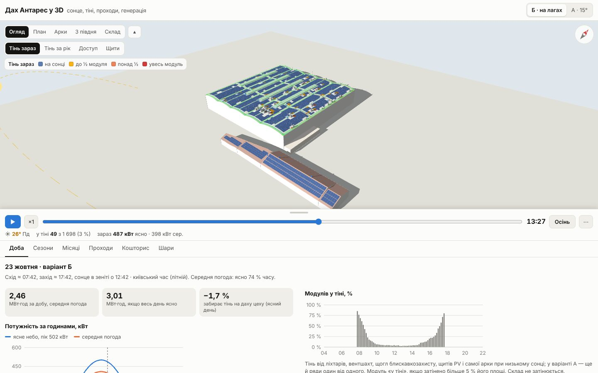
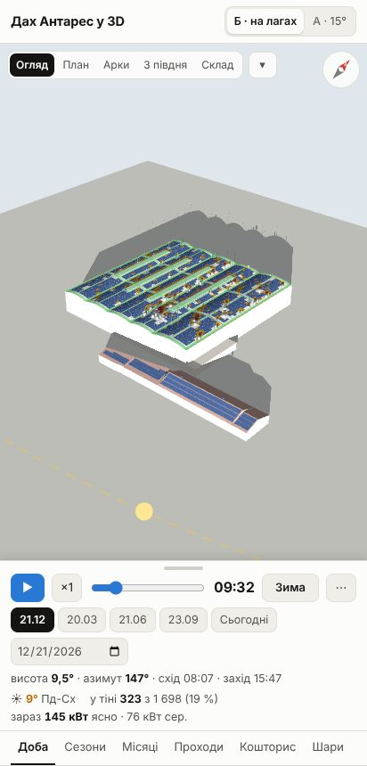

# Антарес — дах у 3D: сонце, тіні, проходи, генерація

Розкладка модулів на арковому даху цеху і на складі ТОВ МК «Антарес» у двох варіантах кріплення. Сонце на будь-яку дату й годину, модулі в тіні, проходи, генерація по годинах і по місяцях, кошторис по розділах.

**Сайт: https://mischenkoa85-creator.github.io/galkat-20/antares/roof/**

Або відкрийте `index.html` у браузері (three.js r128 підтягується з CDN).



## Варіанти
- **Б · на лагах** — модулі лежать по арці паралельно покрівлі (0,12 м), 2384 уздовж гребеня; безперервна лага 41×41 під кожним стиком, сусідні модулі ділять лагу і затиск; 4 блоки на модуль. 1 698 модулів на цеху.
- **А · 15°** — як у проєкті: трикутники 15° на південь, крок рядів 2,10 м, 2 трикутники і 4 блоки на модуль. 1 076 модулів на цеху (без 180 над ендовами і 4 затінених).
- Склад — 180 модулів, однаково в обох варіантах.

## Інтерфейс
- Модель на весь екран. Угорі — види (Огляд, План, Арки, З півдня, Склад) і колір модулів; кнопка ▴ ховає колір і легенду. Компас праворуч повертається разом із камерою.
- Унизу панель: смужку тягнути або натискати — мала / половина / повна. На телефоні відкривається малою.
- Рядок сонця: ▶ запуск, швидкість ×1…×8, повзунок часу (київський час, з літнім), кнопка сезону (Зима → Весна → Літо → Осінь), «⋯» — дата, висота й азимут сонця, схід і захід. Пунктир — шлях сонця за добу.
- Колір модулів: **Тінь зараз**, **Тінь за рік**, **Доступ** (скільки модулів до проходу), **Щити** (до якого PCS іде щит).
- Вкладки: **Доба** (кВт за годинами, частка модулів у тіні), **Сезони** (криві й таблиця кВт·год по годинах для 21.12, 20.03, 21.06, 23.09), **Місяці**, **Проходи**, **Кошторис** (розділи А і Б і всі позиції з кількостями), **Шари**.
- Наведіть або торкніться модуля, щита чи проходу — підказка: щит, стрінг, генерація за рік, тінь, відстань до проходу.



## Як рахується
- Тінь і генерацію сторінка рахує сама в браузері, кожні 10 хв, за тією самою моделлю, що в порівняльному розрахунку 23.10: сонце для Києва (50,45° пн.ш.), ясне небо і хмарність за кліматом місяця, 9 точок на модуль; тінь від ліхтарів, вентшахт, щогл блискавкозахисту, щитів PV, самої арки при низькому сонці, а в А — ще й рядів один від одного. Денні суми для 21.12, 20.03, 21.06 і 23.09 збігаються з розрахунком до 0,1 кВт·год.
- Річна генерація кожного модуля, криві сезонів і місяці — з того самого розрахунку (`src/m3d.json`).
- Кошторис — матеріали + роботи, $ без ПДВ; ціни зі зведення 22.10, кількості з розрахунку 23.10. AC-частина й УЗЕ не входять.

## Що варто знати
- Склад: 57 модулів на односхилій частині лежать на скаті 11° (геометрія макета). У зведенні 22.10 їх пораховано як 22°, тому там рік більший на ≈ 2,5 МВт·год (Б 1 337,5 / А 1 010,6 проти 1 335,0 / 1 008,1 тут). На порівняння А і Б не впливає.
- Блискавкозахист, доставка й кріплення на складі в кошторисі — одним комплектом із зведення, однаково для А і Б. Для Б блискавкозахист і доставку ще треба перерахувати.
- Розміри блоків і щитів на 3D — схематичні.

## Збірка
```
./build.sh   # src/ → index.html
```
Джерела: `src/tpl.html` (розмітка, CSS), `src/app.js` (сцена, модель тіней і генерації, графіки), `src/m3d.json` (модулі, щити, траси, анкери, проходи, сезони, кошторис).
